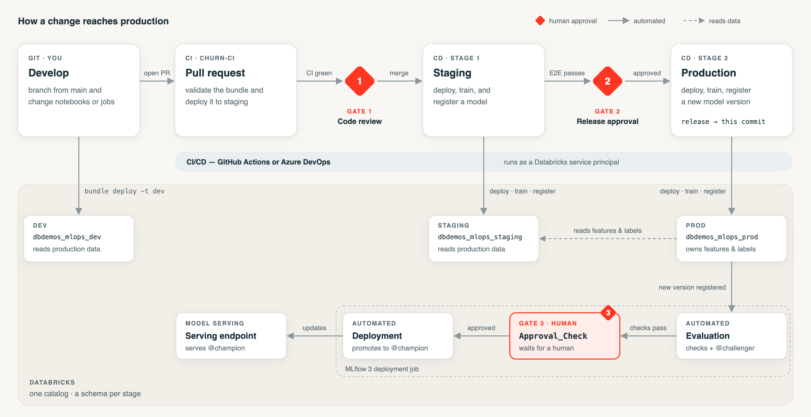

<div align="center">

# MLOps Accelerator for Databricks

**Governed MLOps you can clone: one codebase promoted dev → staging → prod,<br>
three human approval gates, on GitHub Actions or Azure DevOps.**

[](https://docs.databricks.com/dev-tools/bundles/)
[](https://docs.databricks.com/mlflow/deployment-job)
[](.github/workflows)
[](azure-pipelines)
[](.claude/skills/mlops-setup)

<picture>
  <source media="(prefers-color-scheme: dark)" srcset="docs/assets/workflow-dark.png">
  
</picture>

</div>

A reference implementation of governed MLOps on Databricks. One model is promoted
**dev → staging → prod** from a single codebase, governed by **three human approval gates**:

1. **Code review** — a pull request into `main` must pass CI and be approved before it merges.
2. **Pre-production release** — after the change is validated in staging, a human approves the
   promotion to production.
3. **Model approval** — in Unity Catalog, a human approves the trained model before it is served.

Built on the **deploy-code** pattern: one Databricks Asset Bundle, promoted across environments,
each stage an isolated schema. Production owns the data and dev/staging read it, so there are no
copies to drift. Model promotion and serving are governed by an MLflow 3 **deployment job**, and
all CI/CD runs as a Databricks service principal.

The included model is the dbdemos **advanced churn** demo, with the fixes it needs to run under
CI. Use it as is to learn and demo the pattern, or as the scaffold for your own model.

---

## Get started

### With Claude Code

```bash
git clone https://github.com/guanyudb/mlops-accelerator.git
cd mlops-accelerator
claude
```

Then ask it to set up MLOps, or run **`/mlops-setup`**. It asks five questions — CI/CD platform,
the included demo or your own model, which workspace and catalog, where your repository lives,
and whether you want serving and monitoring — then walks the setup phase by phase, checking each
one before moving on.

It stops and hands over the steps it should not do on your behalf: signing in, creating the
CI service principal, and entering its secret. It never prints that secret.

### By hand

Follow **[SETUP.md](SETUP.md)**. The steps are the same ones the skill follows.

---

## How a change reaches production

Gates 1 and 2 live in your CI/CD platform; Gate 3 lives in Databricks, so the model approval
works the same whichever platform you choose. **Three human actions:** approve and merge the
pull request · approve the production release · approve the model.

## CI/CD on each platform

The bundle, the notebooks and Gate 3 are identical on both platforms. Only Gates 1 and 2 differ:

| | GitHub Actions | Azure DevOps |
|---|---|---|
| Pipelines | `.github/workflows/churn-ci.yml`, `churn-cd.yml` | `azure-pipelines/churn-ci.yml`, `churn-cd.yml` |
| Gate 1 | Branch protection on `main`: the `validate` check + 1 approving review | Branch policies on `main`: build validation (`churn-ci`) + minimum reviewers |
| Gate 2 | Environment `prod` with a required reviewer | Environment `prod` with an **Approval** check |
| Gate 3 | Unity Catalog model approval | Unity Catalog model approval |
| Credentials | Secrets `DATABRICKS_HOST`, `DATABRICKS_CLIENT_ID`, `DATABRICKS_CLIENT_SECRET`; variable `DATABRICKS_CATALOG` | Variable group `mlops-databricks` with the same four names |
| Watch out for | Gates 1 and 2 need a **public** repository on the Free plan | Create the `prod` Environment and its approval **before** the first CD run |

Each CI system ignores the other's folder, so one copy of this repository serves both.

**Design notes**
- **Test what you ship.** The commit that passes the staging end-to-end check is the commit
  deployed to production, in the same run.
- **`release` records what production runs.** It moves only after production has deployed, and
  nothing triggers from it, so there is one pipeline run per change and no duplicates.
- **Nothing environment-specific is in the code.** The catalog is a bundle variable and the
  workspace comes from CI credentials, so the same repository deploys anywhere.

## Repository layout

```
churn-mlops/                      # the Databricks Asset Bundle
  databricks.yml                  # dev / staging / prod targets (one schema per stage)
  resources/churn_jobs.yml        # feature engineering, training (+ register), batch inference
  resources/deployment_job.yml    # MLflow 3 deployment job (the model-approval gate)
  src/_resources/00-setup.py      # shared setup: catalog, stage schema, production-owned data
  src/02-mlops-advanced/          # the churn notebooks: features, training, registration,
                                  #   validation, approval, serving, monitoring, drift
.github/workflows/                # GitHub Actions
azure-pipelines/                  # Azure DevOps (+ templates/ for shared steps)
.claude/skills/mlops-setup/       # the setup skill and its reference guides
docs/assets/                      # the diagram above: workflow.html + render.sh -> PNGs
CLAUDE.md                         # orientation for Claude Code
SETUP.md                          # setting up by hand
NOTICE                            # which parts are Apache 2.0 and which are Databricks License
```

## Built on the dbdemos MLOps end-to-end demo

The model pipeline is the **advanced** track of the Databricks
[MLOps - End 2 end pipeline](https://www.databricks.com/resources/demos/tutorials/data-science-and-ai/mlops-end-to-end-pipeline)
demo ([notebooks](https://notebooks.databricks.com/demos/mlops-end2end/index.html)): feature
engineering, Optuna hyperparameter search, Unity Catalog registration, champion/challenger
validation, an MLflow 3 deployment job, real-time serving, and Lakehouse Monitoring.

This project wraps it in an Asset Bundle and CI/CD, and changes it where running under a
pipeline required it:

| Change | Why |
|---|---|
| Validation records its checks and sets `@challenger` but **never approves** | The demo auto-approves and promotes; here a human approves in Unity Catalog (Gate 3) |
| Approval removes `@challenger` when it promotes to `@champion` | A promoted version shows one alias, not two |
| Registration is its own job task after training | Every training run produces a version, so every run reaches the gate |
| The final model is logged in a fresh MLflow run, and each Optuna study gets a unique name | Repeat runs otherwise hit the 1000-metrics-per-model limit, or reload an old study and fail |
| Catalog and stage schema arrive as job parameters; production owns the data | One codebase deploys to every stage and workspace with no edits; dev and staging read production data instead of copying it |
| Serving tolerates a workspace without a serverless budget policy | The model still promotes; the endpoint updates once the policy is granted |
| `pandas` and `cloudpickle` pinned when logging the model | Serving environments otherwise resolve incompatible versions |
| Monitoring and drift notebooks declare their own catalog and schema; `03a` is guarded | They run correctly when opened by hand, and `03a` cannot re-link the model to a job outside CI |
| Usage-tracking beacons removed from the notebooks | |

## Using your own model

Keep the pipeline and the gates; replace the model-specific notebooks. The contract the gates rely
on — the run name and metric training must produce, what validation may and may not do, and the
places the model name appears — is in
[bring-your-own-model.md](.claude/skills/mlops-setup/references/bring-your-own-model.md).

## Current scope

- **One workspace**, stages as schemas. Separate workspaces per stage are not supported yet.
- **Validated:** the Databricks side end to end on two unrelated workspaces, and Gate 3 on both.
  The GitHub pipeline completed a full pull-request-to-production pass, but has not been re-run
  since two later changes. The **Azure DevOps pipelines are new and have not yet completed a
  run**. Details and known
  limitations are in [troubleshooting.md](.claude/skills/mlops-setup/references/troubleshooting.md).

## Notes

- **Model governance is deliberate.** Training in staging and production *registers* a model
  version; production versions do not serve until approved (Gate 3). Approval promotes the version
  to `@Champion`, removes its `@Challenger` alias, and updates the serving endpoint.
- **Solo demos.** Neither platform lets a pull-request author approve their own change. With a
  second reviewer, Gate 1 is satisfied normally; running solo, an administrator can override. The
  automated check is enforced either way.
- **This repository's own CI is skipped.** It is a template with no workspace attached, so the
  workflows skip themselves here and run normally in your copy.

## License

The CI/CD pipelines, bundle configuration, setup skill and documentation are released under the
[Apache License 2.0](LICENSE). The notebooks under `churn-mlops/src/` are adapted from dbdemos and
remain under the [Databricks License](churn-mlops/src/_resources/LICENSE.py), which permits use
only with the Databricks platform. See [NOTICE](NOTICE).
